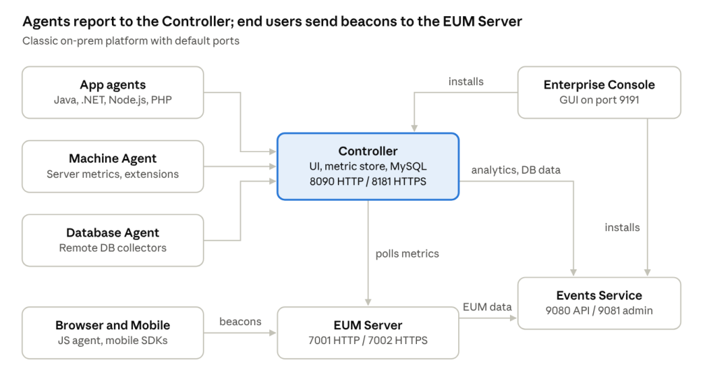

# AppDynamics Professional Implementer (500-430 CAPI) — 10-Day Course

[🏠 Home](README.md) · [Day 1 →](days/day-01-apm-concepts-and-architecture.md) · [📄 PDF version](pdf/00_Course_Outline_10-Day_Plan.pdf)

This page is the course map: what each day covers, the labs, and the facts you must know. The full lesson for each day is linked under its heading.

## Exam at a glance

The target is Cisco exam **500-430 CAPI v1.0**: 90 minutes, US$300, English, proctored by Pearson VUE (online or test centre). Three of the five domains carry 25% each, so on-prem installation, administration and agents together make up three quarters of the exam.

| # | Domain | Weight | Course days |
| --- | --- | --- | --- |
| 1 | Pre-Deployment Planning | 25% | 2, 5, 6 |
| 2 | Platform Installation and Administration | 25% | 3, 4, 5 |
| 3 | Agent Configuration and Installation | 25% | 5, 6, 7 |
| 4 | Post-Deployment Verification | 5% | 3, 8 |
| 5 | APIs | 20% | 9 |

Cisco does not publish the question count or pass mark for v1.0. The older AppDynamics preparation guide listed 50–55 questions (single answer, "choose two" and sentence completion) and a 64% pass mark. Plan for about 1.7 minutes per question.

Sources: [500-430 CAPI exam page](https://cisco.com/site/us/en/learn/training-certifications/exams/capi.html) · [CAPI exam topics (PDF)](https://bxin.cisco.com/c/dam/en_us/training-events/exams/capi.pdf) · [Preparation guide (PDF)](https://appdynamics-cdn.s3.amazonaws.com/education/certification/AppDynamics-Certified-Professional-Implementer-Preparation-Guide.pdf)

## How this course works

Plan on a 2–3 hour session per day and work through the days in order. Every daily page follows the same structure:

1. **Lesson (60–90 min):** concepts explained with examples, config files and commands.
2. **Lab (45–60 min):** a hands-on task in an AppDynamics SaaS trial, or a guided "paper lab" for on-prem steps, with model answers.
3. **Quiz (15 min):** 10 exam-style questions with an answer key and explanations.
4. **Homework:** doc pages to read and flashcards to review before the next day.

**Lab plan with a SaaS trial only.** The SaaS Controller covers agents, Browser RUM, RBAC, health rules and the REST API, which is about half of the blueprint. On-prem installs can't be done in SaaS:

- Enterprise Console, Controller, Events Service, EUM Server
- SSL, high availability and upgrades

For those, the paper labs walk through each step line by line — commands, config files, expected output and common errors — so you can answer scenario questions. If you later get an on-prem license (partner NFR or sales), repeat Days 3–5 on three Linux VMs.

**For the agent labs, prepare:**

- One Linux VM with Java 17 and Tomcat (for the Java, machine and database agents)
- One Windows VM with IIS (for the .NET agent)
- curl or Postman (for the API labs)

## 10-day schedule

Days 2–5 cover on-prem planning and installation, Days 6–7 cover agents, Days 8–9 cover verification and APIs, and Day 10 is a mock exam. Each blueprint objective is listed by number in the Topics column.

| Day | Theme | Topics | Lab type |
| --- | --- | --- | --- |
| 1 | [APM concepts and architecture](days/day-01-apm-concepts-and-architecture.md) | Foundation for all domains | SaaS tour |
| 2 | [Pre-deployment planning and sizing](days/day-02-pre-deployment-planning-and-sizing.md) | 1.1, 1.2, 1.3, 1.5 | Sizing exercise |
| 3 | [Controller install and Enterprise Console](days/day-03-controller-install-and-enterprise-console.md) | 2.1, 4.3 | Paper lab |
| 4 | [SSL, HA, self-monitoring, Controller upgrade](days/day-04-ssl-ha-self-monitoring-upgrades.md) | 2.2, 2.3, 2.4, 2.6 | Paper lab |
| 5 | [Events Service and EUM Server](days/day-05-events-service-and-eum-server.md) | 1.4, 2.5, 2.7, 2.8, 3.7 | Paper lab |
| 6 | [Java and .NET agents, custom correlation](days/day-06-java-and-dotnet-agents-custom-correlation.md) | 1.6, 3.1, 3.2, 3.9, 3.10 | SaaS hands-on |
| 7 | [Machine, Database, Browser, Mobile agents](days/day-07-machine-database-browser-mobile-agents.md) | 3.3, 3.4, 3.5, 3.6, 3.8, 3.11 | SaaS hands-on |
| 8 | [Post-deployment verification and RBAC](days/day-08-verification-rbac-and-revision.md) | 4.1, 4.2, 4.3 | SaaS hands-on |
| 9 | [APIs and extensions](days/day-09-apis-and-extensions.md) | 5.1–5.6 | SaaS + curl |
| 10 | Mock exam and revision (coming soon) | All | 55-question mock |

## Day 1 — APM concepts and architecture

📖 **Full lesson, lab and quiz:** [Day 1 notes](days/day-01-apm-concepts-and-architecture.md)

By the end of Day 1 you can explain how the agents, the Controller and the supporting servers fit together, using the same terms the exam uses.



All data flows into the Controller or the EUM Server. The Enterprise Console installs the Controller and Events Service, but not the EUM Server.

**Lesson**

- **Application model:** a business application contains tiers, and each tier contains nodes. A node is one instrumented process (a JVM, a CLR app pool). A tier is a group of nodes doing the same job.
- **Business transaction (BT):** one type of user request, traced from its entry point (servlet, web service, message listener) through exit calls to backends such as databases and remote services.
- **Diagnosis tools:** flow maps, transaction snapshots with call graphs, dynamic baselines, and health rules that trigger policies and actions.
- **Components:**
  - Controller: UI, metric store and MySQL database
  - App agents: Java, .NET, Node.js, PHP, Python and others
  - Machine Agent: server metrics and extensions
  - Database Agent: monitors databases remotely through collectors
  - Browser and Mobile agents: send beacons to the EUM Server
  - Events Service: stores Analytics, Database Visibility and EUM data
  - Enterprise Console: installs and manages the Controller and Events Service
- **Deployment models:** SaaS, on-premises, and hybrid (on-prem Controller using SaaS EUM and Events Service).

**Lab (SaaS trial)**

1. Open an application's flow map and name its tiers, nodes and backends.
2. Open the business transaction list, sort by response time, and open a slow snapshot's call graph.
3. Find Health Rules and Policies under Alert & Respond.

**Must know for the exam**

- Agents always start the connection to the Controller. The Controller never connects to agents.
- On-prem Controller default ports are 8090 (HTTP) and 8181 (HTTPS).
- A node belongs to exactly one tier, and a tier to one business application.
- A BT is defined by its entry point. Custom match rules change how BTs are detected and named.
- Browser and mobile beacons go to the EUM Server, not to the Controller.

## Day 2 — Pre-deployment planning and sizing

📖 **Full lesson, lab and quiz:** [Day 2 notes](days/day-02-pre-deployment-planning-and-sizing.md)

By the end of Day 2 you can pick a Controller profile, a deployment mode and an Events Service layout from a scenario. That is the heart of Domain 1 (25%).

**Controller sizing (memorise this table)**

| Profile | Max metrics/min | Agents (approx.) | OS | CPU | RAM | Storage |
| --- | --- | --- | --- | --- | --- | --- |
| Demo | 10,000 | 5 | Linux or Windows | 2 cores | 8 GB | 50 GB |
| Small | 50,000 | 50 | Linux or Windows | 4 cores | 16 GB | 400 GB |
| Medium | 1,000,000 | 2,000 | Linux or Windows | 8 cores (16 vCPU on VM) | 128 GB | 5 TB SSD |
| Large | 5,000,000 | 15,000 | Linux only | 28 cores (32 vCPU on VM) | 512 GB (256 GB on VM) | 20 TB SSD + NVMe for redo logs |
| Extra Large | Beyond Large | Beyond Large | — | — | — | Contact Professional Services |

Source: [Controller Sizing, 26.9.0](https://help.splunk.com/en/appdynamics-on-premises/controller-deployment/26.9.0/controller-deployment/controller-system-requirements/controller-sizing)

**Lesson**

- **Sizing drivers:** metric ingestion rate (metrics per minute) first, then the number of agents. Validate against the ingestion rate before production.
- **Controller deployment modes:** a single Controller, or an HA pair (primary and secondary, active-passive). Install with the Enterprise Console GUI, its CLI (`platform-admin.sh`), or silently with a response file.
- **Events Service planning:**
  - Production cluster: at least 3 nodes on dedicated machines with identical hardware, directories and user accounts.
  - Heap: half of RAM, minimum 7 GB, maximum 31 GB.
  - Storage: SSD, ideally 1 TB or more. Retention (8, 30, 60 or 90 days) drives disk size.
  - Port 9080 (REST API) must be reachable from the Enterprise Console.
  - Only Demo and Small setups share the Controller host ("embedded").
- **EUM deployment modes:** SaaS EUM Cloud, or an on-prem EUM Server in demo mode (same host as the Controller) or production mode (its own host).
- **Network:** put a load balancer or reverse proxy with a virtual IP in front of the Controller for HA and SSL.
- **Custom correlation** is needed when an agent can't continue a transaction across an unsupported protocol or framework. It is covered on Day 6.

**Lab: sizing exercise** (answers in the Day 2 quiz)

1. 300 agents, 400,000 metrics/min, Windows only. Which profile?
2. 4,000 agents, 3 million metrics/min. Which profile and which OS?
3. Analytics with 90-day retention for a Large Controller. Where does the Events Service go, and how many nodes at minimum?

**Must know for the exam**

- Large is Linux only. Demo, Small and Medium also run on Windows.
- A large deployment puts the Events Service on a separate cluster, never on the Controller host.
- Events Service heap never goes above 31 GB.

## Day 3 — Controller install and Enterprise Console

📖 **Full lesson, lab and quiz:** [Day 3 notes](days/day-03-controller-install-and-enterprise-console.md)

By the end of Day 3 you can install a Controller three ways (GUI, CLI, silent) and know which admin screen to use for what. This covers blueprint 2.1 and 4.3.

**Lesson: prepare the Linux host**

- Libraries: `libaio` (async I/O), `numactl` (NUMA hosts), `tzdata` (Ubuntu), `ncurses` 5 ABI (`ncurses-compat-libs` or `libncurses5`), `net-tools` (netstat, used to check MySQL).
- User limits for the install user: `nofile` 65535 and `nproc` 8192, hard and soft, in `/etc/security/limits.d/`. Check with `ulimit -S -n` and `ulimit -S -u`.
- Antivirus: exclude the MySQL data directory, `<controller_home>/db/data`.

**Lesson: Enterprise Console (EC)**

- The EC GUI runs on port **9191**. It needs PEM-format SSH keys for remote Linux hosts.
- Remote hosts must be Linux. On Windows, the EC and Controller must be on the same machine.
- **Express Install:** one platform, one host, a single-node Controller plus an embedded Events Service, latest versions only. Default admin user is `admin`.
- **Custom Install:** you choose the versions, the profile, separate Events Service hosts and an HA pair.

**Paper lab: CLI install** (run from `<EC install dir>/platform-admin`)

```bash
./platform-admin.sh create-platform --name lab --installation-dir /opt/appdynamics/platform
./platform-admin.sh add-credential --credential-name labkey --type ssh \
    --user-name appduser --ssh-key-file /home/appduser/.ssh/id_rsa
./platform-admin.sh add-hosts --hosts ctrl01 --credential labkey
./platform-admin.sh submit-job --service controller --job install --args \
    controllerPrimaryHost=ctrl01 controllerAdminUsername=admin \
    controllerAdminPassword=<pwd> controllerRootUserPassword=<rootpwd> \
    mysqlRootPassword=<dbrootpwd> controllerProfile=demo
./platform-admin.sh list-job-parameters --job install --service controller
```

The last command lists every optional install setting. Silent install of the EC itself uses a response file: `./platform-setup-64bit-linux.sh -q -varfile response.varfile`.

**Lesson: admin screens**

- **Controller UI** (`/controller`): applications, users, health rules.
- **Administration Console** (`/controller/admin.jsp`): Controller-wide settings such as EUM and Events Service URLs, and accounts. Log in as `root` with the root user password set at install.
- **Health check URL:** `/controller/rest/serverstatus` returns `<available>true</available>` when the Controller is up.

**Must know for the exam**

- The Controller is an app server plus a MySQL database (port 3388).
- The EC installs the Controller and Events Service only. It does not install the EUM Server.
- The admin password and the root user password are different accounts.

## Day 4 — SSL, high availability, self-monitoring, upgrades

📖 **Full lesson, lab and quiz:** [Day 4 notes](days/day-04-ssl-ha-self-monitoring-upgrades.md)

By the end of Day 4 you can secure a Controller with a CA certificate, build an HA pair, monitor the Controller itself and upgrade the platform in the right order. This covers blueprint 2.2, 2.3, 2.4 and 2.6.

**Lesson: Controller SSL (2.3)**

- HTTPS runs on port **8181** with a self-signed certificate by default.
- Keystore: `<controller_home>/appserver/jetty/etc/keystore.jks`. Truststore: `cacerts.jks` in the same folder.
- The Controller's key alias is **`s1as`** and must not be renamed. The default keystore password is `changeit`; change it.
- Older Controllers ran on GlassFish (`domain.xml`, admin port 4848). Current ones run on Jetty. Exam questions may use either name.

**Paper lab: replace the certificate**

```bash
cd <controller_home>/appserver/jetty/etc
cp keystore.jks keystore.jks.bak            # back up, then stop the Controller
keytool -delete -alias s1as -keystore keystore.jks
keytool -genkeypair -alias s1as -keyalg RSA -keysize 2048 -validity 1825 -keystore keystore.jks
keytool -certreq -alias s1as -keystore keystore.jks -file AppDynamics.csr
# send the CSR to your CA, then import the signed certificate:
keytool -import -trustcacerts -alias s1as -file mycert.cer -keystore keystore.jks
```

If keytool says "Failed to establish chain from reply", import the root and intermediate certificates into `cacerts.jks` first. The Enterprise Console can do the same under Configurations → Controller Settings → SSL Certificate Management.

**Lesson: high availability (2.4)**

- An HA pair is a primary and a secondary Controller, active-passive, with MySQL replicated between them.
- Both servers must be identical in OS, CPU, RAM and disk. EC-managed HA works on Linux only.
- Prerequisites: passwordless SSH between the two hosts, both hostnames in each `/etc/hosts`, and the same database root password.
- Install through EC Custom Install (primary + secondary host), or add a secondary to a standalone Controller with the "Add Secondary Controller" wizard.
- Run `platform-admin.sh submit-job --service controller --job activate-ha-modules` so failover does not depend on the EC.
- Put a load balancer or virtual IP in front. It checks `/controller/rest/serverstatus` and sends traffic to one Controller only, never round-robin.
- Failover is automatic when the primary fails, or manual for maintenance.

**Lesson: self-monitoring (2.2)**

- The Controller ships with its own Java Agent at `<controller_home>/appserver/jetty/appagent/javaagent.jar`. Only that agent is supported for self-monitoring.
- For thread-pool metrics, a Machine Agent collects JMX data (MBean domain `com.appdynamics.serverthreadpools`).
- Best practice: report self-monitoring data to a separate Controller, so a broken Controller can still be diagnosed.

**Lesson: upgrades (2.6)**

- **Order:** Enterprise Console → Events Service → EUM Server → Controller.
- Before upgrading:
  1. Back up the Controller.
  2. Read the release notes for every version in between.
  3. Check `db/logs/database.log` for `InnoDB: Error`.
  4. Note any custom app server settings, which the EC may not keep.
- A profile can only grow (for example Small to Medium), never shrink.
- Since release 20.2, language agents are backward-compatible with any Controller. So agents can be upgraded on their own schedule.

**Must know for the exam**

- Alias `s1as`, password `changeit`, port 8181.
- The HA pair is active-passive and needs identical hardware.
- Upgrade the Controller last among the platform components.

## Day 5 — Events Service and EUM Server

📖 **Full lesson, lab and quiz:** [Day 5 notes](days/day-05-events-service-and-eum-server.md)

By the end of Day 5 you can install an Events Service cluster and a production EUM Server, and connect both to the Controller. This covers blueprint 1.4, 2.5, 2.7, 2.8 and 3.7.

**Lesson: Events Service (2.5, 2.8)**

- Built on Elasticsearch. It stores Transaction Analytics, Log Analytics, Database Visibility and EUM (Browser and Mobile Analytics) data.
- Runs as a single node or as a cluster of **3 or more** nodes.
- Profiles:
  - Production (the default): 4 cores, 12 GB RAM, 128 GB disk minimum.
  - `profile=dev`: non-production only.
- Ports: **9080** API Store, **9081** API Store admin, **9300–9400** traffic between cluster nodes.
- To scale up from the embedded Events Service, use EC → Events Service → More → Scale Up Events Service. Don't include the Controller host. Run `tune-system.sh` on each node and put a load balancer in front.
- Upgrade a cluster from the same EC Events Service page. Remember that the Events Service is upgraded before the EUM Server and the Controller.

**Paper lab: Events Service with the EC CLI** (single node shown; for a 3-node cluster, add all three hosts and pick them in EC Custom Install)

```bash
bin/platform-admin.sh add-hosts --hosts es01 es02 es03 --credential labkey
bin/platform-admin.sh submit-job --platform-name lab --service events-service \
    --job install --args serviceActionHost=es01
# add profile=dev only for a non-production lab node
```

Then, in the Administration Console (`admin.jsp`):

- `appdynamics.on.premise.event.service.url` = `http://<es-vip>:9080`
- `appdynamics.on.premise.event.service.key` = the value of `ad.accountmanager.key.controller` in `events-service-api-store.properties`

**Lesson: EUM Server (1.4, 2.7, 3.7)**

- The Enterprise Console does **not** install the EUM Server. It has its own installer: `euem-64bit-linux-<ver>.sh`, run in GUI or silent mode (`-q -varfile response.varfile`).
- Installation modes:
  - **Demo:** same host as the Controller; light testing only.
  - **Production:** its own host, with its own bundled MySQL.
- Ports: **7001** HTTP, **7002** HTTPS, **3388** MySQL. Install `libaio` first on Linux.
- Passwords for root and `eum_user` must be ASCII and cannot contain `^`, `/` or `$`.
- SSL is best terminated at a reverse proxy in front of the EUM Server.

**Paper lab: connect the EUM Server**

1. Provision the license: from `eum-processor`, run `./bin/provision-license <path-to-license.lic>`.
2. In `eum-processor/bin/eum.properties`, set:

   ```properties
   analytics.enabled=true
   analytics.serverScheme=http
   analytics.serverHost=<es-vip>
   analytics.port=9080
   analytics.accountAccessKey=<value of appdynamics.es.eum.key>
   ```

   Then restart the EUM Server.
3. In the Administration Console, set:
   - `eum.cloud.host` = `http://<eum-host>:7001` (where the Controller polls for EUM metrics)
   - `eum.beacon.host` = `http://<eum-host>:7001` (where browser beacons go over HTTP)
   - `eum.beacon.https.host` = `https://<eum-host>:7002` (beacons over HTTPS)
   - `eum.mobile.screenshot.host` = `http://<eum-host>:7001` (mobile screenshots)

**Must know for the exam**

- Events Service: 9080 / 9081, at least 3 nodes for a cluster, heap 7–31 GB.
- EUM Server: 7001 / 7002, a separate installer, its own MySQL in production mode.
- The Controller **polls** the EUM Server (`eum.cloud.host`). Browsers **send** beacons to it (`eum.beacon.host`).

## Day 6 — Java and .NET agents, custom correlation

📖 **Full lesson, lab and quiz:** [Day 6 notes](days/day-06-java-and-dotnet-agents-custom-correlation.md)

By the end of Day 6 you have a Java app and a .NET app reporting to your SaaS Controller, and you know how to upgrade both agents. This covers blueprint 1.6, 3.1, 3.2, 3.9 and 3.10.

**Lesson: Java Agent (3.1, 3.9)**

- Unzip the agent to a folder the app's user can write to, for example `/opt/appdynamics/javaagent`. Each release sits in its own `ver<version>` subfolder.
- Set the connection in `conf/controller-info.xml`:
  - `controller-host`, `controller-port`, `controller-ssl-enabled`
  - `account-name`, `account-access-key`
  - `application-name`, `tier-name`, `node-name`
- The same settings can be passed as JVM system properties (`-Dappdynamics.agent.tierName=...`) or environment variables. Environment variables override system properties, which override agent.properties, which override `controller-info.xml`.
- Add `-javaagent:/opt/appdynamics/javaagent/javaagent.jar` to the JVM start-up (for Tomcat, `CATALINA_OPTS` in `setenv.sh`) and restart the JVM.
- Logs are in `<agent_home>/ver<version>/logs/<node-name>/`. Check `agent.*.log` first when a node doesn't appear.
- **Upgrade:**
  1. Unzip the new version.
  2. Re-apply your `controller-info.xml` settings and any custom config.
  3. Point `-javaagent` at the new jar.
  4. Restart the JVM. An agent upgrade always needs a JVM restart.

**Lesson: .NET Agent (3.2, 3.10)**

- On Windows, install the MSI (`dotNetAgentSetup64.msi`). Then use the AppDynamics Agent Configuration utility to set the Controller and pick the IIS apps to instrument.
- Silent install: `msiexec /i dotNetAgentSetup64.msi /q /norestart /lv install.log AD_SetupFile=setup.xml`.
- Settings are stored in `config.xml` under `C:\ProgramData\AppDynamics\DotNetAgent\Config\`, and logs under `...\DotNetAgent\Logs\`.
- The **AppDynamics.Agent.Coordinator** Windows service manages instrumentation. Restart IIS (`iisreset`) after installing.
- Windows services and standalone apps must be added to `config.xml` by hand. IIS apps are found automatically.
- .NET on Linux (.NET Core) uses a separate agent package, configured with environment variables.
- **Upgrade:** run the new MSI over the old one (it keeps the configuration), then restart IIS and the instrumented services.

**Lesson: custom correlation (1.6)**

Agents link calls across tiers by adding a correlation header to supported protocols (HTTP, JMS, web services and others). If a call goes over an unsupported protocol or a custom framework, the downstream tier shows up as a separate transaction. Custom correlation fixes that: you define a custom exit point on the caller that adds the header, and a matching entry point on the receiver that reads it.

**Lab (SaaS trial)**

1. Linux VM: Tomcat + Spring PetClinic with the Java Agent. Confirm the tier, the node and at least 3 business transactions.
2. Precedence test: keep `node-name=web01` in `controller-info.xml`, start the JVM with `-Dappdynamics.agent.nodeName=web-sysprop`, and set `APPDYNAMICS_AGENT_NODE_NAME=web-env`. Restart and confirm the node shows as **web-env**, because environment variables win. Remove the variable and it shows web-sysprop; remove both and it shows web01.
3. Windows VM: an IIS sample site with the .NET Agent. Confirm it appears as a second tier.
4. Break it on purpose: put a wrong access key in, read the agent log error, and fix it.
5. Paper design: an order service sends messages to a billing service over a proprietary TCP library and they show as separate BTs. Describe the custom correlation on each side.

**Must know for the exam**

- Configuration precedence: environment variables > system properties > agent.properties > `controller-info.xml`.
- The Java Agent needs the `-javaagent` flag and a JVM restart. The .NET Agent needs an IIS restart.
- Custom correlation is for unsupported protocols or frameworks.

## Day 7 — Machine, Database, Browser and Mobile agents

📖 **Full lesson, lab and quiz:** [Day 7 notes](days/day-07-machine-database-browser-mobile-agents.md)

By the end of Day 7 your lab app has server metrics, database visibility and real-user browser data. This covers blueprint 3.3, 3.4, 3.5, 3.6, 3.8 and 3.11. In the blueprint, "EUEM Processor" is the old name for the EUM Server, and "EUEM Agent" is the old name for the JavaScript agent.

**Lesson: standalone Machine Agent (3.3)**

- Comes as a ZIP bundle with Java included, or as an RPM/DEB package that installs a system service.
- Uses `conf/controller-info.xml`, like the Java Agent. Set `sim-enabled=true` for Server Visibility, which needs its own license units.
- Extensions go in the `monitors/` folder. An optional HTTP listener (off by default, enable with `-Dmetric.http.listener=true`) accepts custom metrics on port 8293 at `/api/v1/metrics`.
- If the Machine Agent and an app agent on the same host use the same unique host ID, the Controller links the server to the app node.

**Lesson: Database Agent (3.4, 3.11)**

- A standalone Java process (`db-agent.jar`) that monitors databases remotely. You don't install it on the database server.
- Create collectors in the Controller UI (Databases → Configuration): database type, host, port and a monitoring user with the right permissions.
- For OS metrics on a Windows database host, the agent uses WMI, which needs WMI permissions on that host.
- Name each agent with `-Ddbagent.name=<name>` when running more than one.
- On-prem, database query data is stored in the Events Service.
- **Upgrade:** stop the agent, unzip the new version, copy over `controller-info.xml`, start it again.

**Lesson: Browser RUM (3.5, 3.8)**

- Create a browser app in the Controller to get its **app key**.
- Injection methods:
  - **Manual:** paste the JavaScript snippet into the page `<head>`.
  - **Automatic:** the Java or .NET agent injects the snippet.
  - **Assisted:** server-side templates.
- For on-prem EUM, point the snippet at your own servers: `beaconUrlHttp`/`beaconUrlHttps` go to the EUM Server, and `adrumExtUrlHttp`/`adrumExtUrlHttps` serve `adrum.js` (from a CDN or self-hosted).

**Lesson: Mobile SDK (3.6)**

- **Android:** add the AppDynamics Gradle plugin, then start the agent with the app key and, for on-prem, the EUM Server's collector URL.
- **iOS:** add the SDK (CocoaPods or Swift Package Manager), then initialise it with the app key and collector URL.
- Crash reports, network requests and screenshots go to the EUM Server. Screenshots use `eum.mobile.screenshot.host`.

**Lab (SaaS trial)**

1. Install the Machine Agent ZIP bundle on the PetClinic VM, set `sim-enabled=true`, and confirm the server is linked to the `web01` node.
2. Restart the Machine Agent with `-Dmetric.http.listener=true` and post `Custom Metrics|Lab|Orders` = 10 to `http://localhost:8293/api/v1/metrics` every minute for 5 minutes. Find it in the Metric Browser.
3. Install MySQL or PostgreSQL, start the Database Agent with `-Ddbagent.name="Lab DB Agent"`, add a collector, and find the top 10 queries.
4. Add the Browser RUM snippet to PetClinic manually, then compare page load times with the server-side response times.
5. Paper task (on-prem): browsers reach the EUM Server through `https://eum.bank.com`. Write the `adrum-config` beacon settings and the Android `withCollectorURL` / `withScreenshotURL` values.

**Must know for the exam**

- The Database Agent monitors remotely. The Machine Agent runs on the host it monitors.
- Browser RUM needs an app key plus a beacon URL.
- On-prem EUM data flow: browser or mobile app → EUM Server → Events Service. The Controller polls the EUM Server for metrics.

## Day 8 — Post-deployment verification and RBAC

📖 **Full lesson, lab and quiz:** [Day 8 notes](days/day-08-verification-rbac-and-revision.md)

By the end of Day 8 you can prove a deployment is healthy and give each team exactly the access it needs. This domain is only 5% of the exam, so the afternoon goes to revising Days 2–5. This covers blueprint 4.1, 4.2 and 4.3.

**Lesson: RBAC (4.1)**

- Building blocks: **users** belong to **groups**, and both get **roles**. A role is a set of account-level and application-level permissions.
- The nine predefined roles are Account Owner, Administrator, Analytics Administrator, Applications and Dashboards Viewer (formerly Read-Only User), Dashboards Viewer, DB Monitoring User, DB Monitoring Administrator, Server Monitoring Administrator and Server Monitoring User. Predefined roles can't be edited, and only the Account Owner can manage users, groups, roles and the authentication provider. Create custom roles for least privilege, for example "view App A only".
- Authentication can be local, LDAP or SAML. With LDAP or SAML, map directory groups to Controller groups so new staff get access automatically.
- On-prem, the **root** user of the Administration Console is separate from account users and admins.

**Lesson: health checks (4.2)**

| Component | Check |
| --- | --- |
| Controller | `http://<ctrl>:8090/controller/rest/serverstatus` returns `<available>true</available>` |
| Events Service | `https://<es>:9080/_ping` returns HTTP 200, or run platform-admin.sh show-events-service-health |
| EUM Server | `http://<eum>:7001/eumaggregator/ping` returns `ping` |
| Agents | Tiers & Nodes → App Agents tab: reporting status and availability |
| Platform | Enterprise Console → Platform: status of each service |

Also check the license usage page, and the Controller log `<controller_home>/logs/server.log`.

**Lesson: Administration Console (4.3)**

- `https://<ctrl>:8181/controller/admin.jsp`, logged in as `root`.
- **Controller Settings:** platform-wide properties, such as the EUM and Events Service URLs and keys from Day 5.
- **Account Settings:** accounts, license details and access keys.
- Default business transaction limits are 50 per agent and 200 per application. When they're reached, new requests go to "All Other Traffic".

**Lab (SaaS trial)**

1. Create a custom role "PetClinic Viewer" with View on PetClinic only, assign it to a group "QA", and log in as a test user to confirm only PetClinic is visible and read-only.
2. Give the test user a second role with Configure Health Rules on PetClinic. Confirm they can now edit health rules, because a grant in any role wins.
3. Create a health rule for average response time over 2 seconds, plus a policy that sends an email.
4. Paper task: write a 10-step post-go-live verification checklist for the bank platform from Day 2.

**Must know for the exam**

- Roles hold permissions; users and groups receive roles.
- Each component's health-check URL and port.
- `admin.jsp` + root user = Controller-wide settings.

## Day 9 — APIs and extensions

📖 **Full lesson, lab and quiz:** [Day 9 notes](days/day-09-apis-and-extensions.md)

By the end of Day 9 you can pull applications, metrics and health rule violations with curl, post a custom event, and explain how alerting and monitoring extensions are installed. APIs are 20% of the exam, so this is a full day. This covers blueprint 5.1–5.6.

**Lesson: authentication**

- **Basic auth:** `--user <user>@<account>:<password>`. On-prem the account is usually `customer1`.
- **API client (OAuth):** create an API client under Settings → Administration, then get a token:

  ```bash
  curl -X POST https://<ctrl>/controller/api/oauth/access_token \
    -d 'grant_type=client_credentials&client_id=<client>@<account>&client_secret=<secret>'
  ```

  Then send `Authorization: Bearer <token>` with each call.
- Add `output=JSON` to get JSON. XML is the default.

**Lesson: Application Model and Metric API (5.5, 5.6)**

| What | URI (all under `/controller/rest`) |
| --- | --- |
| Applications | `/applications` |
| Tiers | `/applications/<app>/tiers` |
| Nodes | `/applications/<app>/nodes` |
| Business transactions | `/applications/<app>/business-transactions` |
| Metric data | `/applications/<app>/metric-data?metric-path=<path>&time-range-type=BEFORE_NOW&duration-in-mins=60&rollup=false` |

- Metric paths use `|` as a separator, for example `Overall Application Performance|Average Response Time (ms)`. Copy the exact path from the Metric Browser (right-click a metric → Copy REST URL).
- `rollup=false` returns each data point. `rollup=true` returns one value for the whole range (the default). The newest docs (25.10+) describe a `metric-data-v2` endpoint with the same parameters; the exam uses the classic `metric-data`.
- Resolution falls as data ages: 1-minute points first, then 10-minute and 1-hour roll-ups. In SaaS, 1-minute data is kept up to 8 days and 1-hour data up to 365 days. On-prem defaults are 4 hours (1-minute), 48 hours (10-minute) and 365 days (1-hour), changed in Controller Settings.

**Lesson: Alert and Respond API (5.2, 5.4)**

- **Health rule violations:** `GET /applications/<app>/problems/healthrule-violations?time-range-type=BEFORE_NOW&duration-in-mins=60`
- **Custom event** (needs the Create Events permission):

  ```bash
  curl -X POST --user admin@customer1:<pwd> \
    'http://<ctrl>:8090/controller/rest/applications/PetClinic/events?severity=INFO&summary=Release%202.1%20deployed&eventtype=CUSTOM&customeventtype=deployment&propertynames=version&propertyvalues=2.1'
  ```
- `time-range-type` can be `BEFORE_NOW`, `BEFORE_TIME`, `AFTER_TIME` or `BETWEEN_TIMES`. `propertynames` and `propertyvalues` pair up by position.
- One call returns at most 600 events.

**Lesson: extensions (5.1, 5.3)**

- **Alerting extension (custom action), on-prem only:**
  1. Put the script in `<controller_home>/custom/actions/<name>/` (`.sh` on Linux, executable; `.bat` on Windows).
  2. Describe it in `<controller_home>/custom/actions/custom.xml`.
  3. Restart the Controller.
  4. Create a Custom Action in the Controller and attach it to a policy. In SaaS, contact support instead.
- **HTTP request actions** are the template-based alternative for webhooks to tools such as ServiceNow or Slack.
- **Monitoring extension:** runs in the Machine Agent's `monitors/` folder. A script prints metric lines such as `name=Custom Metrics|Queue|Depth,value=42`, and they appear in the Metric Browser under Custom Metrics.

**Lab (SaaS trial + curl)**

1. Create an API client (default token expiry 5 minutes), request a token, and call `/controller/rest/applications?output=JSON` with `Authorization: Bearer <token>`.
2. List PetClinic's tiers, nodes, business transactions and backends as JSON.
3. Browse `/metrics`, use Copy REST URL for Average Response Time, run it with `rollup=true` and `rollup=false`, then use a `*` wildcard to get Availability for every tier.
4. Post a "deployment" custom event with properties `version=2.1` and `team=web`, and find it on the PetClinic events list.
5. Pull the last 60 minutes of health rule violations created by your Day 8 rule.
6. Paper task: write `custom.xml` plus a script outline for an on-prem "servicenow" alerting extension, and a Linux monitoring script that reports `Custom Metrics|Lab|TCP Connections`.

**Must know for the exam**

- Every REST call starts with `/controller/rest/applications`.
- Custom event = `POST .../events` with `eventtype=CUSTOM`.
- Custom actions = script + `custom.xml` + Controller restart, on-prem only.

## Day 10 — Mock exam and revision

Day 10 is a timed 55-question mock exam weighted like the real blueprint. Book the real exam only when you score 75% or more, which gives a safe margin over the 64% pass mark in the older preparation guide.

**Morning: mock exam (90 minutes, no notes)**

About 14 questions each on planning, installation and agents, 11 on APIs, and 3 on verification. The formats match the real exam: single answer, "choose two" and sentence completion.

**Afternoon: review**

1. Go through every wrong answer and find the doc page behind it.
2. Re-read the "Must know" lists for your two weakest domains.
3. Take a second 25-question mini-mock on those two domains.

**Exam readiness checklist**

- [ ] I can recite the Controller sizing table (Day 2)
- [ ] I know every default port: 8090, 8181, 3388, 9191, 9080, 9081, 7001, 7002
- [ ] I can put the upgrade order and the install order in sequence
- [ ] I can write the SSL keytool steps for alias `s1as`
- [ ] I can list the HA prerequisites and the health-check URL
- [ ] I can name the Admin Console properties that connect EUM and the Events Service
- [ ] I have installed the Java, .NET, Machine and Database agents in the lab
- [ ] I can write the REST URIs for apps, tiers, nodes, BTs, metrics, violations and events from memory
- [ ] I scored 75% or more on the mock exam

## Study resources and exam-day tips

Use the official docs as the main textbook, and Cisco's free DevNet labs for extra API practice.

**Resources**

- [AppDynamics On-Premises docs](https://help.splunk.com/en/appdynamics-on-premises): the source for every "Must know" fact
- [New Installations Quick Start](https://help.splunk.com/en/appdynamics-on-premises/plan-your-deployment/installation-and-upgrade-overview/installation-and-upgrade-quick-starts/new-installations-quick-start)
- [Upgrade Platform Components](https://help.splunk.com/en/appdynamics-on-premises/upgrade-platform-components)
- [Set Up a High Availability Deployment](https://help.splunk.com/en/appdynamics-on-premises/controller-deployment/26.5.0/controller-deployment/controller-high-availability/set-up-a-high-availability-deployment)
- [Install a Production EUM Server](https://help.splunk.com/en/appdynamics-on-premises/eum-server-deployment/eum-server-deployment/install-a-production-eum-server)
- [Install the Events Service on Linux](https://help.splunk.com/en/appdynamics-on-premises/events-service-deployment/events-service-deployment/install-the-events-service-on-linux)
- [Events API](https://help.splunk.com/en/appdynamics-on-premises/extend-appdynamics/26.3.0/extend-splunk-appdynamics/splunk-appdynamics-apis/alert-and-respond-api/events-api)
- [Create a Custom Action (on-prem)](https://help.splunk.com/en/appdynamics-on-premises/get-started/26.9.0/alert-and-respond/actions/build-a-custom-action/create-a-custom-action-for-splunk-appdynamics-on-premises)
- [Cisco DevNet AppDynamics Fundamentals](https://developer.cisco.com/learning/modules/appdynamics-fundamentals/): free labs
- [CAPI exam resources page](https://www.cisco.com/site/us/en/learn/training-certifications/certifications/appdynamics/professional-implementer/resources.html)
- Paid, optional: [IMP860 On-premise Installation Workshop](https://flane.ch/course-outline/cisco-imp860) (5 days)

**Exam-day tips**

- Avoid "exam dump" sites. They break Cisco's exam agreement, can get your certification revoked, and their answers are often wrong.
- The blueprint is older than the current docs. When a question uses older terms (GlassFish, EUEM Processor), answer for the older product.
- With 90 minutes for about 55 questions, flag anything over 2 minutes and come back to it.
- In "choose two" questions, both answers must be right. Rule out the two you are sure are wrong first.
- For online proctoring, test your webcam and room set-up the day before with Pearson VUE's system check.

---

[🏠 Home](README.md) · [Start Day 1 →](days/day-01-apm-concepts-and-architecture.md)
