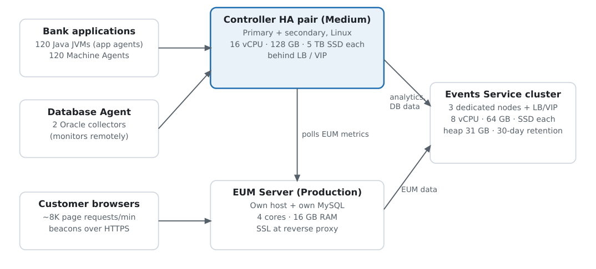

# Day 2 — Pre-Deployment Planning and Sizing

[🏠 Home](../README.md) · [← Day 1](day-01-apm-concepts-and-architecture.md) · [Day 3 →](day-03-controller-install-and-enterprise-console.md) · [📄 PDF version](../pdf/Day02_Pre-Deployment_Planning_and_Sizing.pdf)

Cisco AppDynamics Professional Implementer (500-430 CAPI) · 10-day course · Domain 1 (25% of the exam)

**Goal:** choose a Controller profile, deployment mode, Events Service layout and EUM mode from a customer scenario.

**Verification:** every fact in these notes was checked against the current Splunk AppDynamics on-prem documentation (October 2026). Anything not confirmed is marked **unverified**.

## Blueprint objectives covered

|**#**|**Objective**|**Block**|
|---|---|---|
|1.1|Plan Events Service cluster configuration and timing|5|
|1.2|Assess hardware needs|1, 2|
|1.3|Choose a Controller deployment mode|3|
|1.4|Choose an EUM Server deployment mode|6|
|1.5|Check Controller system requirements|4|
|1.6|Decide when to use custom correlation|7 (preview; full on Day 6)|

## Block 1 — How Controller sizing works

**Official rule:** "The best indicator of the actual workload on your Controller is the metric ingestion rate." Before installing, estimate from the **node count** (for Java, one node = one JVM). After installing, confirm with the **metric upload rate** and keep watching it as the workload grows.

|**Profile**|**Max metrics/min**|**Agents (approx.)**|**OS**|**CPU**|**RAM**|**Storage**|
|---|---|---|---|---|---|---|
|Demo|10,000|5|Linux or Windows|2 cores|8 GB|50 GB|
|Small|50,000|50|Linux or Windows|4 cores|16 GB|400 GB|
|Medium|1,000,000|2,000|Linux or Windows|8 cores (16 vCPU VM)|128 GB|5 TB SSD|
|Large|5,000,000|15,000|**Linux only**|28 cores (32 vCPU VM)|512 GB (256 GB VM)|20 TB SSD + NVMe redo logs|
|Extra Large|Beyond Large|Beyond Large|—|—|—|Contact Professional Services|

**Exam traps:** the Controller figures do **not** include the Enterprise Console or Events Service — provision those separately. A profile can only grow, never shrink. Default agent metric limits: app agent **5,000**, Machine Agent **1,450**.

### Worked example: 80 licensed app agents

- Count every agent: 80 app agents + 80 Machine Agents + 1–2 Database Agents ≈ **162 agents**.

- Worst-case metrics: 80 × 5,000 = 400,000 plus 80 × 1,450 = 116,000 → **≈ 516,000 metrics/min**.

- Small fails (50 agents / 50K metrics). **Medium** fits (2,000 agents / 1M metrics). Even 80 app agents alone exceed Small.

- Headroom (rule of thumb, not official): 516K × 1.3 ≈ 670K — still within Medium.

## Block 2 — Hardware and storage (1.2)

Disk **latency** matters more than raw speed, because MySQL is very sensitive to write latency.

- Primary storage write latency must stay at or below **3 ms** under sustained load. Support won't fix problems caused by slow disks.

- Avoid **NFS** (latency, risk of corruption) and **iSCSI / SAN** storage with network quality-of-service issues. Local disks usually meet requirements.

- MySQL I/O: random 16 KB InnoDB reads/writes; 128 KB log writes. Match RAID stripe size to write size, never below 16 KB.

- For ≥ 1M metrics/min on slow storage: add a mirrored NVMe write-back cache.

- Test with real-world traffic before production.

## Block 3 — Controller deployment modes (1.3)

**A. Where it runs:** SaaS · on-premises · hybrid (on-prem Controller with AppDynamics' cloud EUM).

**B. Availability:** single Controller, or an HA pair (primary + secondary, active-passive). Both servers identical; EC-managed HA is Linux only; load balancer / virtual IP checks `/controller/rest/serverstatus`.

### C. Tenancy:

||**Single-tenant (default)**|**Multi-tenant**|
|---|---|---|
|Accounts|One built-in account, hidden from users|Several accounts (tenants)|
|Login page|No account field|Extra Account field|
|Access|All users see all applications|Users separated by account|
|Use when|Most installations|Very large installs or very separate user groups|
|Switching|Single → Multi possible later|Multi → Single **never** possible|

**Install methods:** EC GUI (Express or Custom), EC CLI (`platform-admin.sh`), or silent with a response file. Prep-guide sample answer: the two Linux installation modes are **silent mode and GUI installer**.

## Block 4 — Controller system requirements (1.5)

- **Linux libraries:** `libaio`, `numactl` (NUMA hosts), `tzdata` (Ubuntu), ncurses 5 compatibility, `net-tools`.

- **User limits:** `nofile` 65535, `nproc` 8192 (hard and soft).

- **Antivirus:** exclude the MySQL data directory `<controller_home>/db/data`.

- **Time sync:** clocks in sync across Controller, EUM Server, Events Service nodes and monitored apps; NTP required for EUM.

- **Windows limits:** Large is Linux only; with the EC on Windows, the EC and Controller must be on the same machine.

## Block 5 — Events Service: configuration and timing (1.1)

|**Rule**|**Value**|
|---|---|
|Node count|Single node, or a cluster of **3 or more** (3 is the minimum for a cluster)|
|Machines|**Dedicated**, with identical directories, user accounts and hardware|
|Heap|**Half of RAM**, minimum 7 GB, **maximum 31 GB**|
|Disk|**SSD**, ideally 1 TB or more|
|Install profile|Production (default): 4 cores, 12 GB RAM, 128 GB disk · profile=dev for non-production only|
|Ports|9080 API (must be reachable from the EC) · 9081 admin · 9300–9400 between nodes|
|Retention|8, 30, 60 or 90 days — directly drives storage|
|Java|Bundled Java 17 from Events Service 23.2.0|

**Sizing by license units** (official tables, AWS i2 instances): a 3-node cluster of i2.2xlarge (61 GB RAM, 8 vCPU, 1.6 TB SSD) handles about **37 Transaction Analytics** or **10 Log Analytics** license units. Log Analytics needs far more capacity per unit.

### Timing

1. Plan the Events Service **before go-live**. After scaling up from the embedded instance, only **new** Database Monitoring data goes to the new cluster; old data stays unless migrated.

2. The Events Service must be running **before** EUM Analytics (Browser and Mobile Request Analytics need it).

3. Observe ingestion over **several days** — events are batched.

4. Upgrade order: Enterprise Console → **Events Service** → EUM Server → Controller.

## Block 6 — EUM deployment mode (1.4)

|**Option**|**When to use it**|
|---|---|
|EUM Cloud (default)|Agents send data to AppDynamics' cloud. Works with an on-prem Controller too|
|On-prem EUM Server — Demo mode|Demonstration and light testing only. Controller must already be installed **on the same machine**|
|On-prem EUM Server — Production mode|EUM and Controller on **different hosts**. Installs its **own separate MySQL**|

**EUM Server hardware (basic):** 4 cores, 8 GB RAM (4 GB max heap), 50 GB extra disk, 10 Mbps, 64-bit Linux or Windows. Handles about 10K page requests/min or 10K concurrent mobile users. On-prem Analytics raises requirements, especially disk. NTP on both EUM and Controller.

|**Peak beacons per minute (beacon every 10 s)**|**RAM**|
|---|---|
|~3K|8 GB|
|~16K–26K|16 GB|
|~33K and above|32 GB|

## Block 7 — Custom correlation (1.6), preview

Agents keep a transaction together across tiers by adding a correlation header to **supported** protocols. Use **custom correlation** when a call goes over an **unsupported protocol or framework** (a custom socket, a proprietary messaging library). Without it, the downstream tier appears as a separate BT. Prep-guide sample answer: needed for calls that **use unsupported frameworks**. Full detail on Day 6.

## Sizing exercise — worked answers

|**Scenario**|**Answer**|**Why**|
|---|---|---|
|300 agents, 400K metrics/min, Windows only|**Medium**|Small fails both limits; Medium allows 2,000 agents / 1M metrics and supports Windows|
|4,000 agents, 3M metrics/min|**Large, on Linux**|Medium tops out at 2,000 agents / 1M metrics; Large is Linux only|
|Analytics, 90-day retention, Large Controller|**Separate dedicated cluster, ≥ 3 nodes, SSD**|Never on the Controller host (prep-guide answer: a separate cluster)|

## Lab (~40 min)

1. **Transaction thresholds:** In your SaaS Controller: application → Configuration → Slow Transaction Thresholds. Record the default values for slow, very slow and stall.

2. **Tenancy:** Look at your SaaS login URL and page — is there an account name? (SaaS is multi-tenant.)

3. **Paper design:** A bank has 120 Java JVMs, 120 Machine Agents and 2 Oracle databases, wants Transaction Analytics for 30 days and Browser RUM at 8K page requests/min. Write down: Controller profile and OS, HA or not, Events Service layout, EUM mode and RAM.

## Day 2 Quiz — with answer key

Try each question first, then open **Show answer** to check.

**Q1. What is the primary consideration when sizing an on-prem Controller?**

- A. Number of business applications
- B. Number of Controller users
- C. Number of health rules
- D. Metric ingestion rate (metrics per minute)

Show answer

**Answer: D** — The docs call the metric ingestion rate the best indicator of Controller workload.

**Q2. 1,500 agents, 800,000 metrics/min, Controller must run on Windows. Which profile?**

- A. Small
- B. Medium
- C. Large
- D. None, because Windows is not supported

Show answer

**Answer: B** — Medium supports ~2,000 agents and 1M metrics/min on Linux or Windows. Large is Linux only.

**Q3. Which Controller profile is supported on Linux only?**

- A. Demo
- B. Small
- C. Medium
- D. Large

Show answer

**Answer: D** — Demo, Small and Medium support Linux or Windows; Large is Linux only.

**Q4. Maximum sustained write latency allowed for Controller primary storage?**

- A. 1 ms
- B. 3 ms
- C. 10 ms
- D. 20 ms

Show answer

**Answer: B** — At or below 3 ms under sustained load. Avoid NFS and SAN/iSCSI with QoS issues.

**Q5. A Controller was installed multi-tenant; the customer wants single-tenant. What can they do?**

- A. Switch in the Administration Console
- B. Switch with platform-admin.sh
- C. Nothing — multi-tenant to single-tenant is not possible
- D. Switch after upgrading the Controller

Show answer

**Answer: C** — Single → multi is possible later; multi → single never is.

**Q6. Events Service heap for a node with 128 GB RAM?**

- A. 64 GB (half of RAM)
- B. 31 GB
- C. 7 GB
- D. 96 GB

Show answer

**Answer: B** — Half of RAM, minimum 7 GB, maximum 31 GB — the cap applies.

**Q7. Which statement about Events Service clusters is correct?**

- A. Minimum of 2 nodes
- B. Minimum of 3 nodes, on dedicated machines with identical hardware
- C. Nodes should share the Controller host
- D. Nodes can differ in hardware if total RAM is enough

Show answer

**Answer: B** — Single node or 3+ nodes, dedicated machines with identical directories, accounts and hardware.

**Q8. After scaling up from the embedded Events Service, what happens to existing Database Monitoring data?**

- A. It moves automatically
- B. It is deleted
- C. It stays in the embedded instance unless migrated
- D. It is copied to the Controller's MySQL

Show answer

**Answer: C** — Only new data goes to the new cluster — plan the cluster before go-live.

**Q9. When must you choose Production mode for the on-prem EUM Server?**

- A. When EUM Server and Controller are on different hosts
- B. When using Browser RUM only
- C. When fewer than 3K beacons/min are expected
- D. When the Controller is single-tenant

Show answer

**Answer: A** — Demo mode needs the Controller on the same machine; Production uses its own host and separate MySQL.

**Q10. Custom correlation is required to keep transaction context for calls that:**

- A. Use HTTP between two Java tiers
- B. Use unsupported protocols or frameworks
- C. Go to a database backend
- D. Run inside the same JVM

Show answer

**Answer: B** — Supported protocols correlate automatically; unsupported ones need custom correlation.

## Quick-review cheat sheet

|**Remember**|**Value**|
|---|---|
|Primary sizing driver|Metric ingestion rate; second: number of agents|
|Profiles (metrics/min · agents)|Demo 10K·5 · Small 50K·50 · Medium 1M·2,000 · Large 5M·15,000|
|Linux only|Large profile; EC-managed HA|
|Agent metric limits|App agent 5,000 · Machine Agent 1,450|
|Disk|Write latency ≤ 3 ms · no NFS · avoid iSCSI/SAN with QoS issues|
|Tenancy|Single-tenant default · single → multi OK · multi → single never|
|Events Service|1 node or ≥ 3 · dedicated identical machines · heap ½ RAM, 7–31 GB · SSD ≥ 1 TB|
|Events Service ports|9080 API · 9081 admin · 9300–9400 cluster|
|Retention options|8 / 30 / 60 / 90 days|
|EUM modes|Cloud (default) · Demo (same host as Controller) · Production (own host, own MySQL)|
|EUM basic hardware|4 cores · 8 GB RAM (4 GB heap) · 50 GB · ~10K page requests/min|
|Custom correlation|Unsupported protocols or frameworks|

## Sources

- [Controller Sizing (26.9.0)](https://help.splunk.com/en/appdynamics-on-premises/controller-deployment/26.9.0/controller-deployment/controller-system-requirements/controller-sizing)

- [Disk I/O Requirements](https://help.splunk.com/en/appdynamics-on-premises/controller-deployment/26.7.0/controller-deployment/controller-system-requirements/disk-io-requirements)

- [About Controller Tenancy Mode](https://help.splunk.com/en/appdynamics-on-premises/controller-deployment/26.3.0/controller-deployment/about-controller-tenancy-mode)

- [Events Service General Requirements](https://help.splunk.com/en/appdynamics-on-premises/plan-your-deployment/component-sizing-considerations/events-service/general-requirements)

- [Events Service Node Sizing by License Units](https://help.splunk.com/en/appdynamics-on-premises/plan-your-deployment/component-sizing-considerations/events-service/events-service-node-sizing-based-on-license-units)

- [EUM Server Hardware Requirements](https://help.splunk.com/en/appdynamics-on-premises/plan-your-deployment/component-sizing-considerations/end-user-monitoring-server/hardware-requirements)

- [Metrics Limits](https://help.splunk.com/en/appdynamics-saas/application-performance-monitoring/26.2.0/administer-app-server-agents/metrics-limits)

- [All Other Traffic Business Transactions](https://help.splunk.com/en/appdynamics-on-premises/application-performance-monitoring/26.3.0/business-transactions/configure-business-transactions/all-other-traffic-business-transactions)

## Model answer — bank deployment design (Day 2 lab task 3)

**Scenario:** 120 Java JVMs, 120 Machine Agents, 2 Oracle databases; Transaction Analytics with 30-day retention; Browser RUM at about 8K page requests per minute. This is how an implementer would answer it, step by step, with the rule behind each choice.

### Bank design: HA Controller pair, dedicated Events Service cluster, production EUM Server

### 1. Controller profile and OS → Medium, on Linux

|**Step**|**Working**|
|---|---|
|Count agents|120 app agents + 120 Machine Agents + 1 Database Agent (2 Oracle collectors) ≈ **241 agents**|
|Worst-case metrics|120 × 5,000 = 600,000 · 120 × 1,450 = 174,000 → **≈ 774,000 metrics/min** (default agent limits; the Database Agent adds a small amount)|
|Pick profile|Small fails (50 agents / 50K metrics).**Medium** fits (2,000 agents / 1,000,000 metrics/min)|
|Headroom|774K × 1.3 ≈ 1.0M — right at Medium's limit (rule of thumb, not official). Real agents usually register fewer metrics than their limit, so run a pilot and confirm with the metric upload rate. If the sustained rate approaches 1M, move to **Large**|
|OS|**Linux.** Medium allows Windows, but Linux is required for Enterprise Console-managed HA and keeps the path to Large (Linux only) open|
|Hardware (each server)|8 cores bare metal / 16 vCPU VM · 128 GB RAM · 5 TB SSD · write latency ≤ 3 ms · no NFS|

### 2. High availability → Yes, an HA pair

- A bank's monitoring platform is business-critical, so a single Controller is a single point of failure.

- **Primary + secondary** Controller, active-passive, with **identical** OS, CPU, RAM and disk (two Medium servers).

- Linux only for EC-managed HA; passwordless SSH between hosts; both hostnames in each /etc/hosts; same database root password.

- Agents and users connect through a **load balancer / virtual IP** that checks `/controller/rest/serverstatus` and sends traffic to one Controller only (no round-robin).

- Run `activate-ha-modules` so failover does not depend on the Enterprise Console.

### 3. Events Service layout → dedicated 3-node cluster

- **Dedicated cluster of 3 nodes** (the minimum for a cluster), never on the Controller hosts, with a load balancer / VIP in front.

- Node size, using the official license-unit table as the reference: i2.2xlarge-class nodes (8 vCPU, ~61–64 GB RAM, ≥ 1.6 TB SSD). A 3-node cluster of this size handles about **37 Transaction Analytics license units**.

- **Heap:** half of 64 GB = 32 GB, so the **31 GB maximum** applies.

- **Retention:** 30 days (allowed values are 8, 30, 60 or 90). Storage grows with retention.

- If the bank's Transaction Analytics license exceeds the table's figure, scale out (5 nodes ≈ 44 units) or use larger nodes (3 × i2.4xlarge ≈ 41 units). Confirm the purchased license-unit count — it drives this choice.

- The cluster also stores Database Monitoring data from the 2 Oracle databases, and Browser Request Analytics if enabled — include that load.

- **Timing:** build it before go-live (scaling up later leaves old Database Monitoring data behind) and observe ingestion over several days.

### 4. EUM mode and RAM → Production mode, 16 GB RAM

- **Production mode** on its **own host** (installs its own MySQL). Demo mode is ruled out: it is for light testing and must share the Controller's machine.

- Base hardware (4 cores, 8 GB) handles about **10K page requests/min**. 8K/min is about 80% of that, so a bank should not run at the minimum: use **16 GB RAM** (the next tier in the beacon table, ~16K–26K beacons/min) with 4 cores.

- Disk: 50 GB base, plus room for resource-timing snapshots (default up to 1K/min kept 15 days → about 64 GB or more recommended).

- Browsers on the internet send beacons over HTTPS: terminate SSL at a **reverse proxy** in front of the EUM Server.

- NTP on both the EUM Server and the Controller. Point the Controller's eum.* properties at the EUM host (Day 5).

### Exam-style summary answer

**Controller:** Medium profile on Linux · **HA:** yes, active-passive pair of identical Linux servers behind a load balancer · **Events Service:** separate dedicated 3-node SSD cluster, heap 31 GB, 30-day retention · **EUM:** on-prem Production mode on its own host, 16 GB RAM (8 GB minimum).

**Judgement calls (not fixed rules):** the 30% headroom, choosing 16 GB over the 8 GB minimum for EUM, and the Events Service node size, which depends on the purchased license units. Everything else follows a documented rule from this session.

---

[← Day 1](day-01-apm-concepts-and-architecture.md) · [🏠 Home](../README.md) · [Day 3 →](day-03-controller-install-and-enterprise-console.md)
