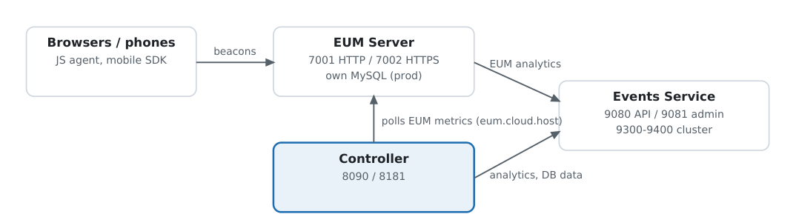

# Day 5 — Events Service and EUM Server

[🏠 Home](../README.md) · [← Day 4](day-04-ssl-ha-self-monitoring-upgrades.md) · [Day 6 →](day-06-java-and-dotnet-agents-custom-correlation.md) · [📄 PDF version](../pdf/Day05_Events_Service_and_EUM_Server.pdf)

Cisco AppDynamics Professional Implementer (500-430 CAPI) · 10-day course · Blueprint 1.4, 2.5, 2.7, 2.8, 3.7

**Goal:** install, connect, run and upgrade the Events Service and the EUM Server. In the blueprint, "EUEM Processor" (3.7) is the old name for the EUM Server.

**Verification:** every fact checked against the current Splunk AppDynamics on-prem docs (November 2026).

## Block 1 — How the pieces connect



### Two different keys connect to the Events Service:

|**Connection**|**Setting**|**Value comes from**|
|---|---|---|
|Controller → Events Service|appdynamics.on.premise.event.service.key (admin.jsp)|ad.accountmanager.key.controller in events-service-api-store.properties|
|EUM Server → Events Service|analytics.accountAccessKey (eum.properties)|appdynamics.es.eum.key (shown in the Administration Console)|

## Block 2 — Install the Events Service (2.5)

Recap: single node or a cluster of **3 or more** dedicated identical machines; heap = half of RAM, **7–31 GB**; SSD; Java 17 bundled.

|**Profile**|**Use**|
|---|---|
|Production (default when no profile is given)|4 cores, 12 GB RAM, 128 GB disk minimum|
|profile=dev|Non-production only (1 core, 1 GB, 2 GB disk)|

- **Ports:** 9080 API store · 9081 API store admin · 9300–9400 between cluster nodes.

- **GUI:** EC → Custom Install → Events Service: profile, hosts (1 node or 3+, more can be added later), optional directories (must differ from platform and MySQL data dirs) and ports.

```
bin/platform-admin.sh add-hosts --hosts es01 es02 es03 --credential eskey
bin/platform-admin.sh submit-job --platform-name bank --service events-service \
    --job install --args serviceActionHost=es01      # profile=dev only for a lab
```

### Scale up from the embedded Events Service

1. Set up a load balancer.

2. EC: add the hosts.

3. Events Service page → More → **Scale Up Events Service** (don't include the Controller host).

4. On each node: `sudo events-service/latest/bin/tool/tune-system.sh`.

5. Point the Controller at the VIP (settings below). The scale-up job restarts the Controller for you.

6. Old Database Monitoring data stays in the embedded instance unless migrated.

- **Connect the Controller** (admin.jsp → Controller Settings): `appdynamics.on.premise.event.service.url` = http://&lt;es-vip&gt;:9080

- `appdynamics.on.premise.event.service.key` = value of `ad.accountmanager.key.controller`

## Block 3 — Run the Events Service

|**Task**|**How**|
|---|---|
|Start / stop|bin/platform-admin.sh submit-job --platform-name &lt;p&gt; --service events-service --job start\|stop|
|Health (CLI)|bin/platform-admin.sh show-events-service-health — issues + suggested fixes|
|Health (GUI)|EC → Platforms → &lt;platform&gt; → Events Service: red critical, green normal; Running State shows inactive hosts|
|Health (HTTP)|https://&lt;es&gt;:9080/_ping → **HTTP 200**|
|Collect logs|bin/platform-admin.sh retrieve-events-service-logs → events-service.log.zip|
|Config files|events-service-api-store.properties · events-service.vmoptions (JVM options)|

## Block 4 — Upgrade the Events Service (2.8)

1. **Upgrade the Enterprise Console first.**

2. No need to stop the Events Service — the EC does it.

3. **GUI:** EC → Events Service page → select hosts → **Upgrade Events Service** → target version (intermediate or latest) → confirm.

4. **CLI:** `bin/platform-admin.sh submit-job --service events-service --job upgrade --platform-name <p>` (log in first with `platform-admin.sh login` if the last session was over a day ago).

5. Failed? Resume with `--args useCheckpoint=true`.

6. Then upgrade the EUM Server, then the Controller.

## Block 5 — Install the EUM Server (3.7)

- Installer: `euem-64bit-linux-<ver>.sh` (Windows .exe as Administrator); GUI or silent `-q -varfile response.varfile`. **Not installed by the Enterprise Console.**

- Prerequisites (Linux): libaio. Events Service running if Analytics will be used.

|**Mode**|**Rule**|
|---|---|
|Demo|Light testing only; Controller already installed and running **on the same machine**|
|Production|Own host; installs a **separate MySQL**|

- Database passwords (root, eum_user): ASCII only, no ^ / $.

- Keystore password set at install. The installer configures the **HTTP port only** — for HTTPS, a **reverse proxy** in front is recommended.

- Ports: 7001 HTTP · 7002 HTTPS · 3388 EUM MySQL.

- JVM options: Linux EUM/eum-processor/bin/eum-processor · Windows eum-processor-launcher.vmoptions.

## Block 6 — Connect, license and verify the EUM Server

### **1. Provision the license** (single-tenant; MySQL running; must run from eum-processor):

```
cd $EUM_HOME/eum-processor
./bin/provision-license <PATH_TO_EUM_LICENSE>     # one license at a time
```

Multi-tenant: provision the same way, then admin.jsp → **Account Settings** → edit each account → **EUM License Key** and **EUM Account Name**.

**2. Connect to the Events Service** — eum-processor/bin/eum.properties, then restart:

```
analytics.enabled=true
analytics.serverScheme=http
analytics.serverHost=<es-vip>
analytics.port=9080
analytics.accountAccessKey=<value of appdynamics.es.eum.key>
```

**3. Point the Controller at the EUM Server** (admin.jsp → Controller Settings):

|**Property**|**Value**|**Purpose**|
|---|---|---|
|eum.cloud.host|http://&lt;eum&gt;:7001|Controller **polls** EUM metrics|
|eum.beacon.host|http://&lt;eum&gt;:7001|JS agent beacons over HTTP|
|eum.beacon.https.host|https://&lt;eum&gt;:7002|Beacons over HTTPS|
|eum.mobile.screenshot.host|http://&lt;eum&gt;:7001|Mobile screenshots|

### 4. Start, stop, verify (Linux):

```
cd <EUM>/eum-processor && bin/eum.sh start          # bin/eum.sh stop
curl http://<eum>:7001/eumaggregator/ping           # replies "ping"
# /eumcollector/ping also works
```

- EUM MySQL is started/stopped with orcha-manager playbooks (start-mysql.orcha / stop-mysql.orcha). Windows: both are services.

- **NTP** on both the EUM Server and the Controller.

## Block 7 — Upgrade the EUM Server (2.7)

1. **Stop the EUM Server — keep its MySQL running.**

2. Back up: whole EUM directory; &lt;EUM_HOME&gt;/jre/lib/security/cacerts (outside the install path); eum_db (mysqldump --add-drop-database); custom eum.properties settings.

3. Set a password in eum-processor/bin/liquibase.properties; copy orcha.properties to the new installation.

4. Run the new EUM installer.

5. After: re-apply custom eum.properties (incl. analytics.accountAccessKey); for HTTPS without a proxy set processorServer.httpsProduction=true and processorServer.httpsPort; restore cacerts; copy back bin/credential.scs.

6. Restart and verify: `curl http://<eum>:<port>/eumcollector/ping` → ping. Platform order: EC → Events Service → **EUM Server** → Controller.

## Paper lab (~45 min)

1. **Events Service cluster:** steps and commands for a production 3-node cluster on es01–es03 behind VIP es-vip.bank.local, and connecting the Controller.

2. **Production EUM Server** on eum01.bank.local: install choices, license step, eum.properties lines and the four Controller properties.

3. **Troubleshooting:** Browser RUM is configured but no browser data appears in the Controller — your checklist, in order.

4. **EUM upgrade:** step-by-step plan including backups and verification.

## Day 5 Quiz — with answer key

Try each question first, then open **Show answer** to check.

**Q1. Which value goes into the Controller's appdynamics.on.premise.event.service.key?**

- A. appdynamics.es.eum.key
- B. ad.accountmanager.key.controller from events-service-api-store.properties
- C. Controller license key
- D. EUM account name

<details><summary>Show answer</summary>

**Answer: B** — Controller → ES uses ad.accountmanager.key.controller; EUM uses appdynamics.es.eum.key.

</details>

**Q2. No profile specified when installing the Events Service — what is installed?**

- A. Dev
- B. Production
- C. Embedded on the Controller host
- D. The install fails

<details><summary>Show answer</summary>

**Answer: B** — Default = production (4 cores, 12 GB, 128 GB).

</details>

**Q3. Which port range do cluster nodes use to talk to each other?**

- A. 9080–9081
- B. 9300–9400
- C. 7001–7002
- D. 3377–3388

<details><summary>Show answer</summary>

**Answer: B** — 9080 API, 9081 admin, 9300–9400 between nodes.

</details>

**Q4. Before upgrading an Events Service cluster through the EC, you must:**

- A. Stop every node manually
- B. Upgrade the EC first (the EC stops the ES for you)
- C. Upgrade the Controller first
- D. Delete old indices

<details><summary>Show answer</summary>

**Answer: B** — Upgrade the EC first; no manual stop needed.

</details>

**Q5. An Events Service upgrade job failed halfway. Resume how?**

- A. Reinstall
- B. Re-run with --args useCheckpoint=true
- C. Run tune-system.sh
- D. Roll back the Controller

<details><summary>Show answer</summary>

**Answer: B** — useCheckpoint=true resumes the job.

</details>

**Q6. Where must ./bin/provision-license run on a Linux EUM Server?**

- A. Any directory
- B. $EUM_HOME/eum-processor
- C. &lt;controller_home&gt;/bin
- D. $EUM_HOME/orcha

<details><summary>Show answer</summary>

**Answer: B** — From eum-processor, with MySQL running, one license at a time.

</details>

**Q7. Which property tells the Controller where to poll EUM metrics?**

- A. eum.beacon.host
- B. eum.cloud.host
- C. eum.mobile.screenshot.host
- D. appdynamics.on.premise.event.service.url

<details><summary>Show answer</summary>

**Answer: B** — eum.cloud.host = polling; beacon hosts = where browsers send beacons.

</details>

**Q8. Multi-tenant Controller: after provisioning EUM licenses, what else?**

- A. Nothing
- B. Enter EUM License Key + EUM Account Name per account in Account Settings
- C. Restart the ES
- D. Reinstall EUM in demo mode

<details><summary>Show answer</summary>

**Answer: B** — Edit each account in admin.jsp → Account Settings.

</details>

**Q9. Upgrading a production EUM Server — how do you handle its MySQL at the start?**

- A. Stop EUM and MySQL
- B. Stop EUM, keep MySQL running
- C. Drop eum_db
- D. Move MySQL to the Controller

<details><summary>Show answer</summary>

**Answer: B** — MySQL must stay up to dump eum_db and for the upgrade.

</details>

**Q10. Which URL confirms an EUM Server is running?**

- A. /controller/rest/serverstatus on 7001
- B. /eumaggregator/ping (or /eumcollector/ping) → 'ping'
- C. https://&lt;eum&gt;:9080/_ping
- D. http://&lt;eum&gt;:9191

<details><summary>Show answer</summary>

**Answer: B** — 9080/_ping is the Events Service; serverstatus is the Controller; 9191 is the EC.

</details>

## Quick-review cheat sheet

|**Remember**|**Value**|
|---|---|
|ES ports|9080 API · 9081 admin · 9300–9400 cluster|
|ES nodes / heap|1 or ≥ 3 · heap ½ RAM, 7–31 GB · default profile = production|
|Controller → ES|event.service.url = http://&lt;vip&gt;:9080 · key = ad.accountmanager.key.controller|
|EUM → ES|eum.properties analytics.* · accountAccessKey = appdynamics.es.eum.key|
|ES health|show-events-service-health · https://&lt;es&gt;:9080/_ping → 200|
|ES upgrade|EC first · no manual stop · --job upgrade · resume useCheckpoint=true|
|EUM install|Own installer (not EC) · Demo = same host as Controller · Production = own host + own MySQL|
|EUM ports|7001 HTTP · 7002 HTTPS · 3388 MySQL|
|EUM license|cd eum-processor · ./bin/provision-license &lt;file&gt; · multi-tenant → Account Settings key + name|
|Controller eum.* props|cloud.host (poll) · beacon.host · beacon.https.host · mobile.screenshot.host|
|EUM verify|/eumaggregator/ping or /eumcollector/ping → ping|
|EUM upgrade|Stop EUM, keep MySQL · back up dir, cacerts, eum_db · new installer · restore config + credential.scs|
|Order|EC → Events Service → EUM Server → Controller|

## Sources

- [Install the Events Service on Linux](https://help.splunk.com/en/appdynamics-on-premises/events-service-deployment/events-service-deployment/install-the-events-service-on-linux)

- [Administer the Events Service](https://help.splunk.com/en/appdynamics-on-premises/events-service-deployment/events-service-deployment/administer-the-events-service)

- [Upgrade the Multi-Node Events Service Cluster for Linux](https://help.splunk.com/en/appdynamics-on-premises/events-service-deployment/events-service-deployment/upgrade-the-events-service/upgrade-the-multi-node-events-service-cluster-for-linux)

- [Events Service General Requirements](https://help.splunk.com/en/appdynamics-on-premises/plan-your-deployment/component-sizing-considerations/events-service/general-requirements)

- [Install a Production EUM Server](https://help.splunk.com/en/appdynamics-on-premises/eum-server-deployment/eum-server-deployment/install-a-production-eum-server)

- [Install a Demo EUM Server](https://help.splunk.com/en/appdynamics-on-premises/eum-server-deployment/eum-server-deployment/install-a-demo-eum-server)

- [Provision EUM Licenses](https://help.splunk.com/en/appdynamics-on-premises/eum-server-deployment/eum-server-deployment/provision-eum-licenses)

- [Start and Stop the EUM Server and Database](https://help.splunk.com/en/appdynamics-on-premises/eum-server-deployment/eum-server-deployment/start-and-stop-the-eum-server-and-database)

- [Upgrade the Production EUM Server](https://help.splunk.com/en/appdynamics-on-premises/eum-server-deployment/eum-server-deployment/upgrade-the-production-eum-server)

- [Upgrade Platform Components](https://help.splunk.com/en/appdynamics-on-premises/upgrade-platform-components)

## Paper lab — model answers

How an implementer would answer each Day 5 paper-lab task, with the rule behind each step.

### 1. Production 3-node Events Service behind es-vip.bank.local

**Prepare:** three dedicated, identical Linux hosts (same directories, user, hardware), SSD ≥ 1 TB, clocks synced. With 64 GB RAM per node the heap is **31 GB** (cap). Open 9080/9081 to the EC and Controller, and 9300–9400 between nodes.

### Install:

```
bin/platform-admin.sh add-credential --credential-name eskey --type ssh \
    --user-name appduser --ssh-key-file /home/appduser/.ssh/appd.pem
bin/platform-admin.sh add-hosts --hosts es01 es02 es03 --credential eskey
# EC GUI → Custom Install → Events Service: production profile (no profile=dev),
#   hosts es01, es02, es03  → Install, watch the Jobs page
```

- **Load balancer:** VIP es-vip.bank.local:9080 → es01–es03:9080; health check https://&lt;node&gt;:9080/_ping expecting 200.

- **Connect the Controller** (admin.jsp → Controller Settings): appdynamics.on.premise.event.service.url = http://es-vip.bank.local:9080; appdynamics.on.premise.event.service.key = ad.accountmanager.key.controller from events-service-api-store.properties.

- **Verify:** platform-admin.sh show-events-service-health; EC Events Service page all green; allow a few minutes for account information to sync.

### 2. Production EUM Server on eum01.bank.local

1. Install libaio; chmod 775 euem-64bit-linux-&lt;ver&gt;.sh and run it (or -q -varfile response.varfile).

2. Choose **Production** mode (separate host → separate MySQL). Set root and eum_user passwords (ASCII, no ^ / $) and the keystore password.

3. License: cd $EUM_HOME/eum-processor; check MySQL is running (ps aux | grep mysql); ./bin/provision-license /opt/licenses/license.lic.

4. eum.properties: analytics.enabled=true · analytics.serverScheme=http · analytics.serverHost=es-vip.bank.local · analytics.port=9080 · analytics.accountAccessKey=&lt;appdynamics.es.eum.key&gt;. Then bin/eum.sh stop and bin/eum.sh start.

5. Controller (admin.jsp → Controller Settings): eum.cloud.host = http://eum01.bank.local:7001 · eum.beacon.host = http://eum01.bank.local:7001 · eum.beacon.https.host = https://eum01.bank.local:7002 · eum.mobile.screenshot.host = http://eum01.bank.local:7001.

6. NTP on EUM and Controller. Internet browsers send HTTPS beacons → put a reverse proxy with a CA-signed certificate in front.

7. Verify: curl http://eum01.bank.local:7001/eumaggregator/ping → ping.

### 3. Browser RUM configured but no data in the Controller — checklist

|**#**|**Check**|**Why**|
|---|---|---|
|1|EUM Server up: /eumaggregator/ping returns ping|No server, no data|
|2|EUM license provisioned (MySQL running, run from eum-processor); multi-tenant → key + account name in Account Settings|Unlicensed EUM accepts no data|
|3|JS snippet uses the right app key and its beacon URLs point to the on-prem EUM Server (HTTPS pages need the HTTPS beacon URL)|Beacons may be going to the SaaS cloud or blocked as mixed content|
|4|Browsers can reach the beacon host: DNS, firewall, reverse proxy, certificate|Beacons come from users' browsers, not from your servers|
|5|Controller eum.cloud.host points to the EUM Server|The Controller polls EUM for metrics|
|6|NTP in sync on EUM Server and Controller|Clock skew breaks data alignment|
|7|For Browser Analytics: eum.properties analytics.* settings and key; Events Service healthy (_ping 200)|Analytics data goes EUM → Events Service|

### 4. EUM Server upgrade plan

|**Step**|**Action**|
|---|---|
|0. Order|Do it after the EC and Events Service upgrades, before the Controller|
|1. Stop|Stop the EUM Server (bin/eum.sh stop) —**keep its MySQL running**|
|2. Back up|Whole EUM directory · jre/lib/security/cacerts (outside the install path) · mysqldump eum_db --add-drop-database · note custom eum.properties|
|3. Prepare|Set a password in eum-processor/bin/liquibase.properties · copy orcha.properties to the new installation|
|4. Install|Run the new euem-64bit-linux installer|
|5. Restore|Re-apply custom eum.properties (incl. analytics.accountAccessKey) · HTTPS without proxy → processorServer.httpsProduction=true + httpsPort · restore cacerts · copy bin/credential.scs|
|6. Verify|Restart; curl http://eum01.bank.local:7001/eumcollector/ping → ping; check browser data and analytics in the Controller|
|Rollback|Restore the EUM directory backup and the eum_db dump|

---

[← Day 4](day-04-ssl-ha-self-monitoring-upgrades.md) · [🏠 Home](../README.md) · [Day 6 →](day-06-java-and-dotnet-agents-custom-correlation.md)
